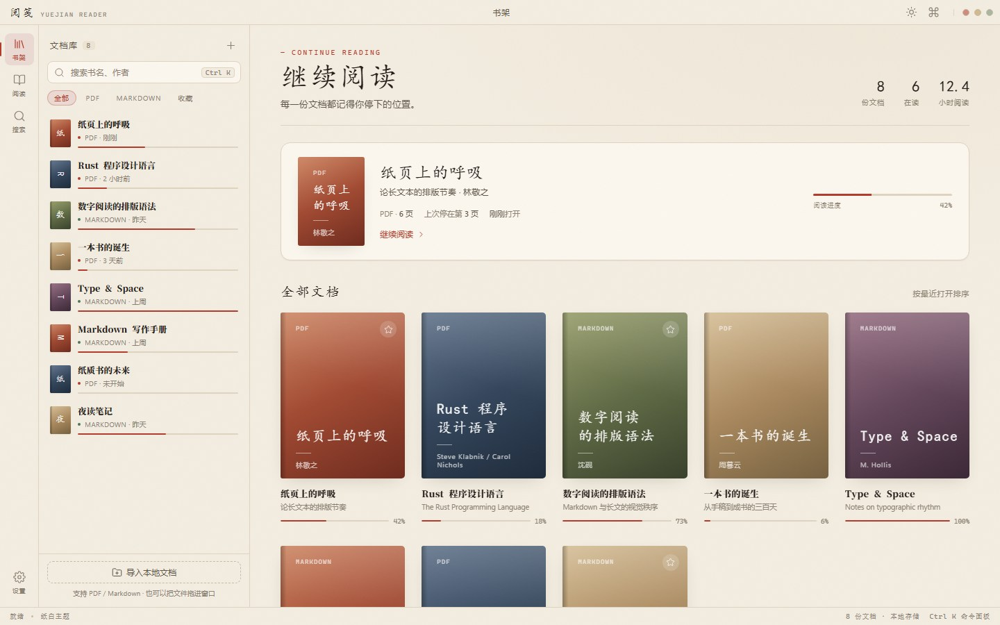

# YueJian Reader

English · [简体中文](README.md)

> PDF papers and Markdown notes, in one quiet reading space.

A local-first desktop reader: a Rust + Tauri 2 shell, PDF rendering with pdf.js, and Markdown rendering with comrak. No account, no cloud sync, no telemetry — every document and reading record stays on your machine.

[](LICENSE)
[](https://tauri.app)
[](https://www.rust-lang.org)
[](https://github.com/biashz/yuejian/releases)
[](https://yuejian-reader.vercel.app)



## Features

- **PDF reading**: pdf.js renders a continuous scroll with a transparent text layer for selection and copy; long documents load lazily around the viewport.
- **Three sidebar views**: jump by document outline, locate by thumbnail, or search and highlight keywords across the whole document.
- **Markdown reading**: comrak renders GFM on the Rust side (tables, task lists, footnotes, strikethrough, autolinks); headings get automatic outline anchors and code blocks are syntax-highlighted.
- **Reading typography**: Paper / Night / Sepia themes; body size 15 / 17 / 19 / 21px, line height 1.7 / 1.9 / 2.1, measure 620 / 720 / 820px; Focus mode hides everything but the text.
- **Reading progress**: page, zoom, and scroll position are saved automatically, so the next open returns to where you stopped.
- **Command palette**: `Ctrl/Cmd + K` to search books, jump to sections, switch themes, open settings, or import files.
- **Bilingual UI**: switch between Simplified Chinese and English in Settings; the choice is remembered.
- **Local first**: shelf, settings, and progress live in `data/` next to the app. Works offline, and copying that folder migrates everything.

More screens are on the [website](https://yuejian-reader.vercel.app) and in the [user guide](docs/usage.md).

## Download

| Platform | Installer | Requirements |
| --- | --- | --- |
| Windows | `YueJian.Reader_<version>_x64-setup.exe` (NSIS) | Windows 10 1803+ / WebView2 |
| macOS | `YueJian.Reader_<version>_universal.dmg` | macOS 10.15+, universal for Intel and Apple Silicon |
| Linux | `YueJian.Reader_<version>_amd64.deb`, `amd64.AppImage` | Distributions with WebKitGTK 4.1 |

Installers are published on [GitHub Releases](https://github.com/biashz/yuejian/releases) and built on all three platforms by GitHub Actions.

Notes:

- **Data location**: release builds write all data to `data/` next to the executable; the Linux AppImage writes next to the `.AppImage` file. Move or remove that folder along with the app.
- **First launch on macOS**: the installer is not notarized by Apple. If macOS says the developer cannot be verified, right-click the app and choose "Open", or run `xattr -dr com.apple.quarantine "/Applications/YueJian Reader.app"`.
- **Linux AppImage**: run `chmod +x` on the downloaded file before launching.

## Tech stack

| Layer | Choice | Notes |
| --- | --- | --- |
| App shell | Tauri 2 | Rust backend + system WebView; small bundle, clear permission model |
| Frontend | Vanilla HTML / CSS / ES Modules | No bundler, no build step; loads as-is at startup |
| PDF rendering | pdf.js | Canvas rendering + text layer + search |
| Markdown | comrak | GFM parsing on the Rust side, sanitized HTML output |
| Code highlighting | highlight.js | Official browser build, shipped offline |
| Persistence | serde_json | Single `state.json`, written to a temp file and renamed |
| Icons | Lucide (inline SVG) | Zero external dependencies |
| Website | Static HTML + CSS | Hosted on Vercel, configured in `vercel.json` |

## Project structure

```
yuejian/
├── src/                     # Frontend (loaded directly as Tauri's frontendDist)
│   ├── index.html
│   ├── styles.css
│   ├── js/
│   │   ├── app.js           # App wiring, shelf, command palette, settings
│   │   ├── api.js           # The only gateway from the frontend to Rust commands
│   │   ├── i18n.js          # Chinese/English dictionaries and language switching
│   │   ├── reader-pdf.js    # pdf.js wrapper: rendering, paging, zoom, search
│   │   └── reader-md.js     # Markdown rendering and outline scroll sync
│   └── vendor/              # Offline assets generated by npm run vendor
├── src-tauri/
│   ├── src/
│   │   ├── main.rs          # Entry point
│   │   ├── lib.rs           # Window creation and command registration
│   │   ├── commands.rs      # Shelf, import, progress, and settings commands
│   │   ├── markdown.rs      # Markdown → HTML and outline extraction
│   │   ├── store.rs         # state.json read/write and data structures
│   │   └── paths.rs         # Runtime data directory resolution
│   ├── tauri.conf.json      # Shared configuration
│   ├── tauri.windows.conf.json / .linux / .macos   # Per-platform bundle targets
│   └── capabilities/        # Permission allowlists
├── site/                    # Static marketing site (Vercel source)
├── scripts/
│   ├── dev.mjs              # Unified dev / build / bundle entry
│   └── vendor-assets.mjs    # Extracts pdf.js and friends from node_modules
├── docs/                    # Product, design, development, and usage docs
├── .github/workflows/build.yml   # Three-platform build + release upload
└── vercel.json              # Website hosting configuration
```

## Local development

Prerequisites: Node.js 20+, Rust 1.77+, and the WebView dependencies for your platform (WebView2 on Windows; `libwebkit2gtk-4.1-dev`, `libgtk-3-dev`, and friends on Linux).

```bash
npm install      # Install the Tauri CLI and pdf.js
npm run vendor   # First run or after upgrading deps: sync pdf.js assets and highlight.js into src/vendor
npm run dev      # Incremental debug build and launch
```

In debug builds the data directory is `.data/` at the project root, so `src-tauri/target` stays clean.

### Common commands

| Command | Purpose |
| --- | --- |
| `npm run dev` | Incremental debug build and launch (the frontend is plain files — just rerun after edits) |
| `npm run build` | Compile a release binary without an installer (`tauri build --no-bundle`) |
| `npm run bundle` | Build an installer for the current platform |
| `npm run vendor` | Sync offline frontend assets into `src/vendor`: pdf.js from `node_modules`, highlight.js from the official browser build |
| `npm run version:bump` | Bump the version manually (patch by default; supports `--minor` / `--major` / `--set 1.2.3`) |
| `npm run tauri -- <args>` | Pass any arguments through to the Tauri CLI |

Downloaded build dependencies stay inside the project: the Cargo target directory is set by the scripts and the npm cache is pointed at `.cache/npm` by `.npmrc`. On Windows, the bundler temporarily links `%LOCALAPPDATA%\tauri` to `.cache/tauri` and removes only the link afterwards.

## Build and release

[.github/workflows/build.yml](.github/workflows/build.yml) runs three jobs in parallel when a `v*` tag is pushed (or on manual `workflow_dispatch`):

1. `windows-latest` → NSIS installer
2. `ubuntu-22.04` → deb + AppImage
3. `macos-latest` → universal (`--target universal-apple-darwin`) dmg

Each job uploads an artifact and, on tag builds, appends its platform files to the same-named release with `softprops/action-gh-release`. Release notes are generated only by the Windows job to avoid duplication.

Versioning rules:

- The version lives in `package.json`, `src-tauri/tauri.conf.json`, `src-tauri/Cargo.toml`, and `Cargo.lock`; [scripts/bump-version.mjs](scripts/bump-version.mjs) updates all of them at once and fails if any file lacks a version field, so versions never end up half-updated.
- On every push to `main`, [.github/workflows/version.yml](.github/workflows/version.yml) patch-bumps the latest commit (`0.1.0` → `0.1.1`) and commits back as `chore(release): vX.Y.Z [skip version]`. Bumps on the same branch run serially to avoid conflicts.
- As a result, your local copy lags one commit behind CI after a bump — run `git pull --rebase` before pushing again.
- Automatic bumps do not create tags; installers are still triggered by manually pushed `v*` tags. The tag must equal `v` + the current version (version `0.1.10` → tag `v0.1.10`); [build.yml](.github/workflows/build.yml) verifies this and fails on a mismatch.
- The release flow is therefore: `git pull` for the latest version, then tag and push that version. Installers, release notes, and the in-app version stay in sync.
- To skip a bump, put `[skip version]` at the beginning of the commit message (the marker anywhere else in the body does not count).

## Data and migration

```
data/
├── state.json      # Shelf + settings + reading progress
└── webview2/       # System WebView user data directory (WebView2 on Windows)
```

`state.json` structure (excerpt):

```jsonc
{
  "version": 1,
  "books": [
    {
      "id": "a1b2c3",              // Hashed from the file path; re-importing never duplicates
      "path": "D:\\docs\\paper.pdf",
      "title": "Breath on Paper",
      "author": "",
      "kind": "pdf",               // pdf | markdown
      "size": 2483102,
      "pages": 6,
      "words": 0,
      "addedAt": 1762300000,
      "lastOpenedAt": 1762390000,
      "favorite": false,
      "progress": { "ratio": 0.42, "page": 3, "zoom": 1.0 }
    }
  ],
  "settings": {
    "theme": "paper",              // paper | night | sepia
    "fontSize": 17,
    "lineHeight": 1.9,
    "measure": 720,
    "showCtx": true,
    "zen": false,
    "language": "zh"               // zh | en
  }
}
```

## Website

[site/](site/) is a static site separate from the app. It includes the canonical URL, Open Graph / Twitter cards, `SoftwareApplication` and `FAQPage` structured data, `robots.txt`, and `sitemap.xml`.

[vercel.json](vercel.json) sets `site/` as the output directory and skips install and build, so importing the repository needs no manual configuration. Once Vercel's Git integration is connected, pushing `main` redeploys automatically. If you change the domain, update the canonical / og:url / og:image values in `site/index.html` as well as `site/robots.txt` and `site/sitemap.xml`.

## Documentation

| Document | Contents |
| --- | --- |
| [User guide](docs/usage.md) | Installation, import, reading, shortcuts, data migration, FAQ |
| [Product spec](docs/product-spec.md) | Positioning, scenarios, feature map, non-functional requirements, data model |
| [Design contract](docs/design-contract.md) | Visual tokens, component specs, app shell, and page list |
| [Development plan](docs/dev-plan.md) | Milestones and implementation order |

## Contributing

Issues and pull requests are welcome. Keep the frontend free of build steps; new Rust commands must be registered in `commands.rs` and exposed to the frontend through `js/api.js`.

## License

[MIT](LICENSE) © 2026 bias
