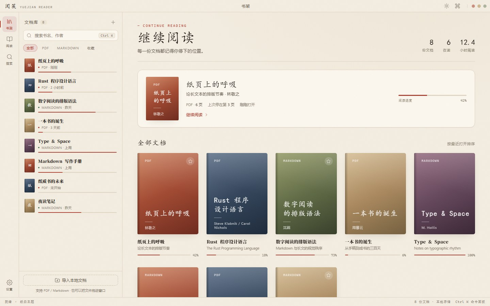

# 阅笺 YueJian Reader

[English](README.en.md) · 简体中文

> 把 PDF 论文与 Markdown 笔记放进同一个安静的阅读空间。

本地优先的桌面阅读器：Rust + Tauri 2 外壳、pdf.js 渲染 PDF、comrak 渲染 Markdown。无账号、无云同步、无遥测，所有文档与阅读记录都留在本机。

[](LICENSE)
[](https://tauri.app)
[](https://www.rust-lang.org)
[](https://github.com/biashz/yuejian/releases)
[](https://yuejian-reader.vercel.app)



## 功能

- **PDF 阅读**：pdf.js 连续滚动渲染，叠加透明文本层支持选择复制；长文档按视口懒加载。
- **侧栏三视图**：文档大纲跳章节、缩略图定位、全文档关键词搜索与高亮。
- **Markdown 阅读**：Rust 端 comrak 渲染 GFM（表格、任务列表、脚注、删除线、自动链接），标题自动生成目录锚点，代码块语法高亮。
- **阅读排版**：纸白 / 夜读 / 护眼三套主题；正文字号 15 / 17 / 19 / 21px、行高 1.7 / 1.9 / 2.1、版心 620 / 720 / 820px；专注模式收起非正文元素。
- **阅读进度**：页码、缩放与滚动位置自动保存，下次打开回到原处。
- **命令面板**：`Ctrl/Cmd + K` 搜书、跳章节、切换主题、打开设置、导入文件。
- **双语界面**：简体中文 / English 可在设置中即时切换，选择会被记住。
- **本地优先**：书架、设置与进度写在程序目录内的 `data/`，断网可用，复制目录即可迁移。

其他界面见 [官网](https://yuejian-reader.vercel.app) 与 [用户手册](docs/usage.md)。

## 下载

| 平台 | 安装包 | 系统要求 |
| --- | --- | --- |
| Windows | `YueJian.Reader_<version>_x64-setup.exe`（NSIS） | Windows 10 1803+ / WebView2 |
| macOS | `YueJian.Reader_<version>_universal.dmg` | macOS 10.15+，Intel 与 Apple Silicon 通用 |
| Linux | `YueJian.Reader_<version>_amd64.deb`、`amd64.AppImage` | 带 WebKitGTK 4.1 的发行版 |

安装包发布在 [GitHub Releases](https://github.com/biashz/yuejian/releases)，由 GitHub Actions 在三个平台上分别构建。

注意事项：

- **数据位置**：发布版的所有数据写入可执行文件同级的 `data/`；Linux AppImage 写入 `.AppImage` 文件同级目录。卸载或迁移时连同该目录一起处理即可。
- **macOS 首次打开**：安装包未做 Apple 公证，若提示“无法验证开发者”，请右键点击应用选择「打开」，或执行 `xattr -dr com.apple.quarantine "/Applications/YueJian Reader.app"`。
- **Linux AppImage**：下载后需要 `chmod +x` 再运行。

## 技术栈

| 层 | 选型 | 说明 |
| --- | --- | --- |
| 应用外壳 | Tauri 2 | Rust 后端 + 系统 WebView，包体小、权限模型清晰 |
| 前端 | 原生 HTML / CSS / ES Module | 无打包器、无构建步骤，启动即加载 |
| PDF 渲染 | pdf.js | 画布渲染 + 文本层 + 搜索 |
| Markdown | comrak | Rust 侧 GFM 解析，输出净化后的 HTML |
| 代码高亮 | highlight.js | 官方浏览器构建，随包离线分发 |
| 持久化 | serde_json | 单文件 `state.json`，先写临时文件再重命名 |
| 图标 | Lucide（内联 SVG） | 零外部依赖 |
| 官网 | 静态 HTML + CSS | 通过 Vercel 托管，配置见 `vercel.json` |

## 项目结构

```
yuejian/
├── src/                     # 前端（作为 Tauri 的 frontendDist 直接加载）
│   ├── index.html
│   ├── styles.css
│   ├── js/
│   │   ├── app.js           # 应用装配、书架、命令面板、设置
│   │   ├── api.js           # 前端调用 Rust 命令的唯一出口
│   │   ├── i18n.js          # 中英文案字典与语言切换
│   │   ├── reader-pdf.js    # pdf.js 封装：渲染、翻页、缩放、搜索
│   │   └── reader-md.js     # Markdown 渲染与目录滚动同步
│   └── vendor/              # 由 npm run vendor 生成的离线资源
├── src-tauri/
│   ├── src/
│   │   ├── main.rs          # 入口
│   │   ├── lib.rs           # 窗口创建与命令注册
│   │   ├── commands.rs      # 书架、导入、进度、设置等命令
│   │   ├── markdown.rs      # Markdown → HTML 与目录提取
│   │   ├── store.rs         # state.json 读写与数据结构
│   │   └── paths.rs         # 运行时数据目录解析
│   ├── tauri.conf.json      # 通用配置
│   ├── tauri.windows.conf.json / .linux / .macos   # 各平台打包目标
│   └── capabilities/        # 权限白名单
├── site/                    # 官网静态站（Vercel 部署源）
├── scripts/
│   ├── dev.mjs              # dev / build / bundle 统一入口
│   └── vendor-assets.mjs    # 从 node_modules 提取 pdf.js 等资源
├── docs/                    # 产品、设计、开发与使用文档
├── .github/workflows/build.yml   # 三端构建 + Release 上传
└── vercel.json              # 官网托管配置
```

## 本地开发

前置条件：Node.js 20+、Rust 1.77+，以及各平台 WebView 依赖（Windows 为 WebView2，Linux 需 `libwebkit2gtk-4.1-dev`、`libgtk-3-dev` 等）。

```bash
npm install      # 安装 Tauri CLI 与 pdf.js
npm run vendor   # 首次或升级依赖后：把 pdf.js 资源与 highlight.js 同步到 src/vendor
npm run dev      # 增量编译 debug 版并启动应用
```

数据目录在调试构建下为项目根目录的 `.data/`，不会污染 `src-tauri/target`。

### 常用命令

| 命令 | 作用 |
| --- | --- |
| `npm run dev` | 增量编译 debug 版并启动应用（前端为原生文件，改动后重新运行即可） |
| `npm run build` | 编译 release 二进制但不生成安装包（`tauri build --no-bundle`） |
| `npm run bundle` | 构建当前平台的安装包 |
| `npm run vendor` | 同步前端离线资源到 `src/vendor`：pdf.js 取自 `node_modules`，highlight.js 下载官方浏览器构建 |
| `npm run version:bump` | 手动递增版本号（默认 patch，可加 `--minor` / `--major` / `--set 1.2.3`） |
| `npm run tauri -- <args>` | 透传任意 Tauri CLI 参数 |

构建期下载的依赖都收敛在项目内：Cargo 目标目录由脚本指定，npm 缓存由 `.npmrc` 指向 `.cache/npm`；Windows 打包时脚本会把 `%LOCALAPPDATA%\tauri` 临时链接到 `.cache/tauri`，结束后只移除链接。

## 构建与发布

[.github/workflows/build.yml](.github/workflows/build.yml) 在 `v*` 标签推送（或手动 `workflow_dispatch`）时并行执行三个任务：

1. `windows-latest` → NSIS 安装包
2. `ubuntu-22.04` → deb + AppImage
3. `macos-latest` → 通用架构（`--target universal-apple-darwin`）dmg

每个任务上传 Artifact，并在打标签时用 `softprops/action-gh-release` 把本平台产物追加到同名 Release；Release 说明只由 Windows 任务生成，避免重复。

版本号规则：

- 版本号同时存在于 `package.json`、`src-tauri/tauri.conf.json`、`src-tauri/Cargo.toml` 与 `Cargo.lock`，由 [scripts/bump-version.mjs](scripts/bump-version.mjs) 一次改齐，任一文件缺少版本字段会直接失败，不会留下半新半旧的版本号。
- 每次 push 到 `main`，[.github/workflows/version.yml](.github/workflows/version.yml) 会在最新提交上自动 patch 递增（`0.1.0` → `0.1.1`），并以 `chore(release): vX.Y.Z [skip version]` 提交回仓库；同一分支的递增串行执行，避免并发冲突。
- 因此 CI 递增后本地会落后一个提交，下次推送前先 `git pull --rebase`。
- 自动递增不创建标签，安装包仍由手动推送的 `v*` 标签触发构建；标签必须等于 `v` + 当前版本号（例如版本 `0.1.10` 对应标签 `v0.1.10`），[build.yml](.github/workflows/build.yml) 会校验，不一致直接失败。
- 因此发版流程是：先 `git pull` 拿到最新版本号，再按该版本号打标签推送；这样安装包、Release 与应用内显示的版本号始终一致。
- 需要跳过某次递增时，把 `[skip version]` 写在提交信息开头（正文中出现该字样不会触发跳过）。

## 数据与迁移

```
data/
├── state.json      # 书架 + 设置 + 阅读进度
└── webview2/       # 系统 WebView 的用户数据目录（Windows 下即 WebView2）
```

`state.json` 结构（节选）：

```jsonc
{
  "version": 1,
  "books": [
    {
      "id": "a1b2c3",              // 由文件路径哈希生成，重复导入不会产生副本
      "path": "D:\\docs\\paper.pdf",
      "title": "纸页上的呼吸",
      "author": "",
      "kind": "pdf",               // pdf | markdown
      "size": 2483102,
      "pages": 6,
      "words": 0,
      "addedAt": 1762300000,
      "lastOpenedAt": 1762390000,
      "favorite": false,
      "progress": { "ratio": 0.42, "page": 3, "zoom": 1.0 }
    }
  ],
  "settings": {
    "theme": "paper",              // paper | night | sepia
    "fontSize": 17,
    "lineHeight": 1.9,
    "measure": 720,
    "showCtx": true,
    "zen": false,
    "language": "zh"               // zh | en
  }
}
```

## 官网

[site/](site/) 是独立于应用的静态站点，包含 SEO 所需的 canonical、Open Graph / Twitter 卡片、`SoftwareApplication` 与 `FAQPage` 结构化数据、`robots.txt` 与 `sitemap.xml`。

[vercel.json](vercel.json) 把 `site/` 指定为输出目录并跳过安装与构建，导入仓库后无需任何手动配置；完成 Vercel 的 Git 集成后，push `main` 即自动重新部署。若更换域名，需要同步修改 `site/index.html` 中的 canonical / og:url / og:image，以及 `site/robots.txt`、`site/sitemap.xml`。

## 文档

| 文档 | 内容 |
| --- | --- |
| [用户手册](docs/usage.md) | 安装、导入、阅读、快捷键、数据迁移与常见问题 |
| [产品功能规划](docs/product-spec.md) | 定位、场景、功能地图、非功能需求、数据模型 |
| [设计契约](docs/design-contract.md) | 视觉 token、组件规范、App Shell 与页面清单 |
| [开发任务规划](docs/dev-plan.md) | 里程碑拆解与实现顺序 |

## 参与贡献

欢迎提交 Issue 与 Pull Request。改动前端时保持零构建步骤；新增 Rust 命令需在 `commands.rs` 中注册，并通过 `js/api.js` 暴露给前端。

## 许可证

[MIT](LICENSE) © 2026 bias
